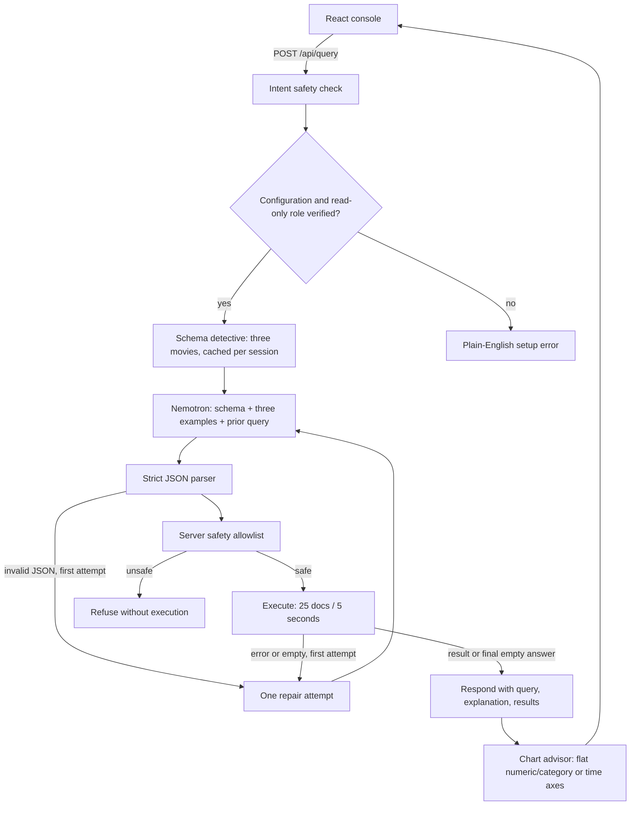

# AskMongo

A read-only natural-language MongoDB analyst. Idea by **Chenyun Yang (CMU)**.

Ask a question, inspect the generated query and safety checks, follow a repair if one is needed, and explore the returned documents or chart. The console streams an **execution trace** of server actions and validation verdicts, not the model's private chain of thought.

## Start in under 10 minutes

Requires Node.js **22.12+ or 24 LTS**, npm, an Atlas cluster with the `sample_mflix` sample dataset, and a NVIDIA NIM API key. Provisioning an Atlas cluster and loading its sample dataset may take additional time.

```sh
npm ci
cp .env.example .env
# Fill in MONGODB_URI and NIM_API_KEY in .env using your editor.
npm run dev
```

Open **http://127.0.0.1:5173**. One command starts Vite on 5173 and Express on 3001. Keep `PORT=3001` for the supplied Vite proxy. If you change it, update `vite.config.ts` too.

1. In Atlas, load the sample dataset, allow your development machine's IP, and create a dedicated database user with **only the built-in `read` role on `sample_mflix`**. Do not grant `readWrite`, `readAnyDatabase`, admin, or custom roles. Set its connection string as `MONGODB_URI` (URL-encode special password characters).
2. Obtain a NIM key from [NVIDIA's Nemotron 3 Ultra playground](https://build.nvidia.com/nvidia/nemotron-3-ultra-550b-a55b), and set `NIM_API_KEY`.
3. Restart `npm run dev`. The backend must log **“Atlas read-only role verified. Ready for queries.”** Health must return HTTP 200 before running live checks.
4. Open `/console`, choose an example, then ask it. Use the follow-up field for “Now only comedies.” The main query bar starts a fresh analysis.

Without credentials, both servers still start and the landing page/dashboard remain usable. The backend prints an explicit **STARTUP CONFIGURATION ERROR**, `/api/health` returns 503, and normal queries return an actionable 503. No fabricated database results are shown. Unsafe requests are still refused before schema/model/execution calls.

## Configuration

| Variable | Visibility | Purpose |
|---|---|---|
| `MONGODB_URI` | Server only | Atlas connection using the dedicated read-only user |
| `NIM_API_KEY` | Server only | NVIDIA hosted API authentication |
| `PORT` | Server only | Express port; default `3001` |
| `VITE_API_URL` | Public/browser | API base **including `/api`**. Leave empty for same-origin `/api` |
| `NIM_MODEL` | Server only, optional | Defaults to `nvidia/nemotron-3-ultra-550b-a55b`; override only with a model your account supports |

`.env` is gitignored. Never prefix either secret with `VITE_`. The server reads `.env` with Node's built-in loader. Sample documents, schema, and questions are sent to NVIDIA for query generation; no MongoDB credentials are sent. Model availability, quota, and JSON-mode behavior must be checked with your own key.

For hosting, use one origin and reverse-proxy `/api` to Express. The supplied server binds to loopback. A cross-origin `VITE_API_URL` needs CORS configured by your deployment; this app does not enable wildcard CORS. This is a local development app, not a public multi-tenant service: add authentication, user-scoped sessions/metrics, and rate limiting before exposing it publicly.

## Agent architecture



The API emits NDJSON events when the client asks for `Accept: application/x-ndjson`. Every event is a real server stage, rendered verbatim in expandable trace steps. Ordinary clients, including curl, receive one JSON response. There are at most **two model calls and two database executions** per question (plus the first session's schema read). A repair always goes through validation again. A safety refusal is never repaired or executed. An empty result gets one review that must preserve the user's constraints, then is returned honestly if still empty.

The response's explanation comes from the validated model plan, with execution outcome appended; chart selection is deterministic and does not require another model call. Charts use accessible SVG and a data table, without a chart library. `react-spring` is an npm alias for the official `@react-spring/web` package, avoiding the umbrella package's unused native/3D dependencies. It animates trace entry, result staggering, loading shimmer, and query focus; reduced-motion preferences disable those animations.

## Three independent read-only layers

1. **Allowlist**: only `movies` and `find`/`aggregate`. Only approved operators are allowed recursively. Aggregation stages are limited to `$match`, `$group`, `$sort`, `$limit`, `$skip`, `$project`, `$unwind`, `$count`. `$where`, `$function`, `$accumulator`, mapReduce, write stages, joins, nested pipelines, administrative operations, unsafe object keys, and arbitrary driver options are rejected. Input complexity and string lengths are bounded. The early natural-language intent screen is deliberately conservative; a read question containing words such as “drop” may need rephrasing.
2. **Resource caps**: the validator normalizes find limits and appends an aggregation limit. The database adapter independently enforces 25 returned documents, `maxTimeMS: 5000`, a driver `timeoutMS: 5000`, and closes cursors in `finally`. Disk-backed aggregations are disabled. These limits cap returned rows, not the number scanned by MongoDB. Driver connection/server-selection timeouts are also five seconds.
3. **Atlas credentials**: at startup a fixed, non-model-controlled [connectionStatus metadata command](https://www.mongodb.com/docs/manual/reference/command/connectionstatus/) verifies that every assigned role is exactly `read` on `sample_mflix`. Unverifiable or broader roles disable query execution. No write is attempted to test permissions. Model-controlled operations can only reach the fixed movies collection through the read adapter. MongoDB's own authentication/handshake/cursor-management protocol also uses internal commands.

Sessions expire after one hour of inactivity, have a maximum count of 500, and serialize requests per session. Concurrent requests are capped at eight. Metrics retain 168 hourly buckets and lifetime counters since server startup. Neither sessions nor metrics survive a restart. Keep session IDs private; there is no account system.

## API

```sh
curl -i http://127.0.0.1:5173/api/health
curl -s http://127.0.0.1:5173/api/query \
  -H 'Content-Type: application/json' \
  -d '{"question":"Movies starring Tom Hanks released after 2000","sessionId":"my-movies-session"}'
curl -s http://127.0.0.1:5173/api/query \
  -H 'Content-Type: application/json' \
  -d '{"question":"Now only comedies","followUp":true,"sessionId":"my-movies-session"}'
curl -s http://127.0.0.1:5173/api/query \
  -H 'Content-Type: application/json' \
  -d '{"question":"Movies released per year"}'
curl -s http://127.0.0.1:5173/api/metrics
```

`followUp` can also be a string. A follow-up without a previous successful query returns 409. Session IDs are optional and server-generated when omitted; supplied IDs need 8–80 letters, numbers, hyphens, or underscores.

Responses include `sessionId`, `mongoQuery` (structured plan), `explanation`, `results`, `steps`, optional `chartSpec`, `repaired`, and `latencyMs`. Errors include `error`. Statuses: 400 malformed request, 409 missing/busy session, 422 safety refusal, 429 capacity, 502 exhausted repair/service failure, 503 setup unavailable. In streaming mode HTTP is already 200: the final event contains the effective `status` and `answer`.

Dashboard repair rate is requests that attempted a repair divided by all completed requests. “Self-healed” counts requests where a failed/empty first attempt becomes nonempty after repair. Average latency includes refusals and failures. All counters are actual requests, including local acceptance-test requests.

## Verification

```sh
npm test
npm run test:repair
npm run build
```

Tests require no Atlas/NIM connection. They cover the parser, nested forbidden operations, role verification, adapter-level limits, chart advice, repair bounds, revalidation of repairs, schema caching, context isolation, and concurrent session locks. `test:repair` writes `review/repair-fixture.json`, explicitly labeled **unit-test fixture, not Atlas data**, showing `release_year` corrected to `year`.

Live acceptance requires your credentials: Tom Hanks results, the real repair path, “Now only comedies,” and “Movies released per year” with a rendered chart. Start with a schema-mismatch question to exercise repair, but an accurate model may succeed immediately; never introduce a production backdoor or fake failure to claim a live repair occurred. Record actual before/after queries from the trace when a genuine error or empty-result review happens.

Historical Gate 1 screenshots remain in `review/`. See `review/completion-verification.md` for the current tested/pending checklist. MIT license is preserved at the root.
